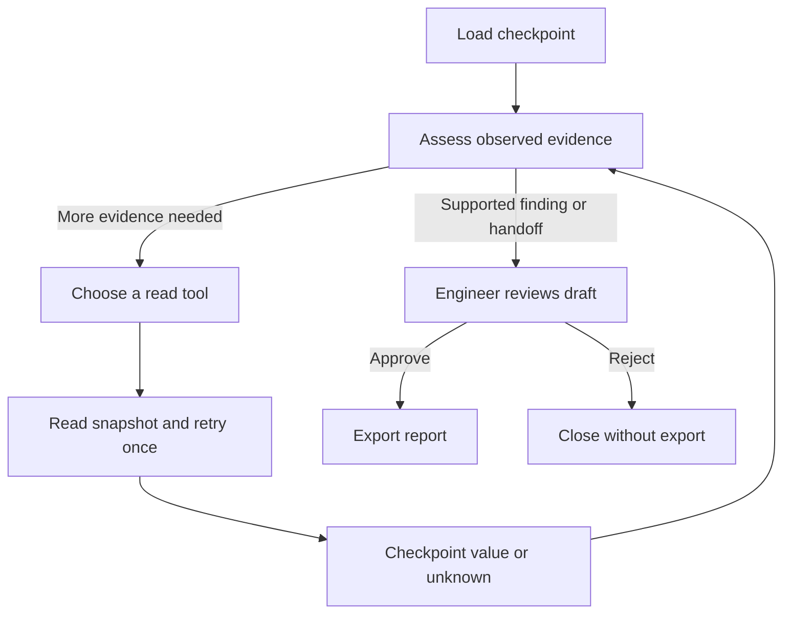

# RouteTrace

A Week 3 Gen Academy agent for an on-call network engineer investigating one missing BGP advertisement. Give it a normalized capture of R2 between R1 and R3. It chooses its next read, explains the first sufficiently supported finding, recovers from tool failures and pauses for human review before exporting an incident report.

## Run the demonstration

Tested on CPython 3.15.2 and LangGraph 1.2.20. The default planner runs locally without model credentials. From the project directory:

```sh
python3 -m venv .venv
source .venv/bin/activate
python -m pip install -r requirements.txt
python route_trace.py cases
python route_trace.py start --case transient-export --steps 1
```

The last command prints a run ID and stops after one read. Substitute that ID for RUN_ID in the commands below. Each command starts a new process and reopens the SQLite checkpoint.

```sh
python route_trace.py resume RUN_ID
python route_trace.py show RUN_ID
python route_trace.py review RUN_ID approve --note "Verified local selection and effective export deny."
python route_trace.py export RUN_ID incident.md
python route_trace.py start --case incomplete-export
python -m unittest -v
```

Use `review RUN_ID reject --note "Collect a fresh capture."` to reject a pending draft. A terminal approval or rejection cannot be changed. To investigate a newer capture, start a new run. The global `--db PATH` option goes before the command and defaults to routetrace.sqlite3.

## Evidence and agent design

R1 supplies the only candidate path for the prefix. R2 selects the route and may advertise it to R3. All observations refer to one instant, VRF, prefix and address family. The six read tools inspect ingress receipt, import policy, next-hop resolution, local selection, export policy and the egress peer view. Policy values describe the *effective decision for this prefix*. The fixtures use the documentation prefix 203.0.113.0/24. There are no router logins or device writes.



LangGraph runs a planning node and a conditional tool node. The default model enumerates six diagnostic hypotheses. For each unread tool it estimates expected entropy reduction under the current observations and divides by read cost. The priors are uniform. The 0.97 agreement parameter and costs are hand-set simulation assumptions. Exact evidence predicates control whether a finding can be reported. The probabilistic score only decides what to inspect next.

An optional installed Ollama model can choose the next tool using the same evidence and allowlist. Start Ollama separately, then run `python route_trace.py start --case export-filter --model YOUR_INSTALLED_MODEL`. Invalid model output or a timeout switches that run to the offline planner. The integration was tested with controlled responses and a failed connection. Live model inference was not verified in this environment.

## Use another capture

Supply a single JSON object following one entry in scenarios.json via `start --snapshot capture.json`. Fields include id, prefix, VRF, ingress, egress, captured_at, and reads. Each read contains a normalized value and evidence locator. A missing read is unknown. The optional nonnegative failures field simulates timeouts for that tool. Partial failure and conflicting observations can produce a handoff. Run records keep the exact input snapshot, observations, attempts, decisions and review note in SQLite. Files stay on disk until their owner removes them.

## Verification and limits

Eight regression tests cover ten labeled scenarios, restart recovery, retry exhaustion, malformed inputs, planner fallback and human review. All ten cases matched their expected disposition, including three handoffs. The policy selected between one and six distinct reads per case. These are authored development scenarios; the numbers do not measure performance on production incidents.

The agent reports an observed blocker in this narrow topology. It may stop before discovering a second fault. Multiple candidate paths, mixed-time captures, vendor CLI parsing, live routers and multi-hop attribution require a different evidence model. Source references: [BGP-4](https://www.rfc-editor.org/rfc/rfc4271.html) and [default eBGP policy](https://www.rfc-editor.org/rfc/rfc8212.html).
